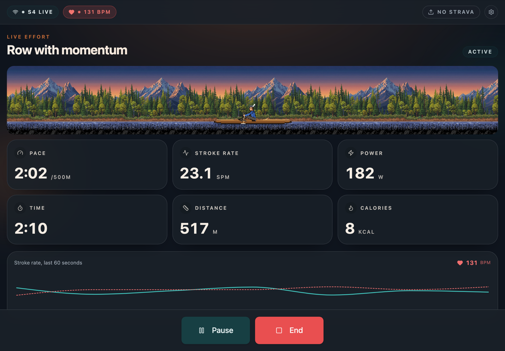
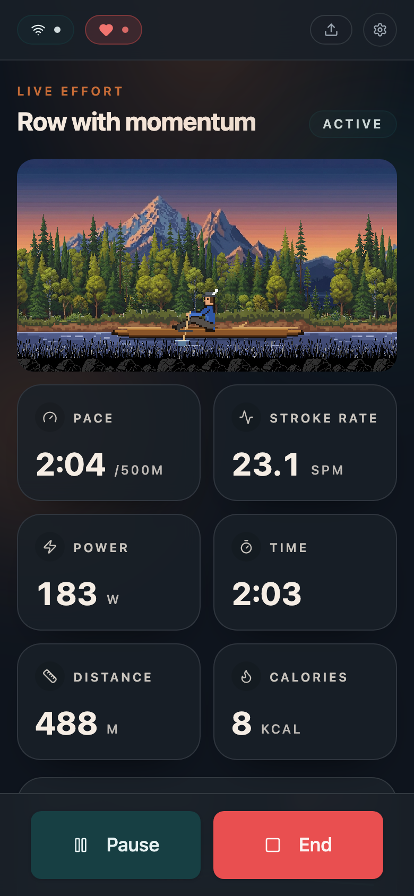
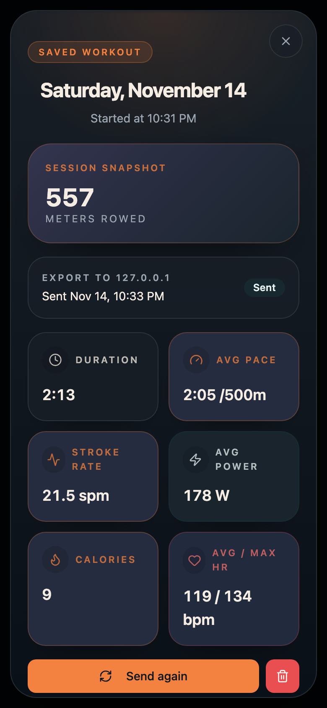

# BuoyCast

**A live rowing dashboard for the WaterRower S4, running on a Raspberry Pi.**

BuoyCast plugs into your WaterRower's S4 monitor over USB and turns your phone
or tablet into a big, glanceable workout screen: pace, stroke rate, power and
heart rate, with a little sculler that rows in time with your real strokes.
Every workout is saved on the Pi, and can be sent to Strava or to your own
server when you finish.

<p align="center">
  
</p>
<p align="center">
  
  &nbsp;
  
</p>

## Features

- **Live dashboard** for iPhone, iPad and Android. Add it to your home screen
  and it runs full screen and keeps the display awake. Big numbers you can read
  mid-stroke.
- **Heart rate** from a Bluetooth chest strap (tested with the Wahoo TICKR),
  shown live and charted against stroke rate.
- **Hands-free workouts:** notices when you start rowing and offers to start
  a workout, pauses when you stop, resumes on your next stroke, and offers
  to end after a long break.
- **Workout history** on the Pi, with every second of data. Workouts survive
  power cuts.
- **Send workouts anywhere:** POST each finished workout to your own endpoint
  as JSON or a FIT file ([docs/export.md](docs/export.md)), and/or upload to
  Strava.
- **Bluetooth FTMS broadcast** of your rowing data, for apps that accept
  third-party rowers. Peloton pairing is still experimental (see below).
- **One-line install and in-app updates** from GitHub Releases, with
  automatic rollback if an update fails.

## What you need

- A WaterRower with the **S4** monitor
- A **Raspberry Pi Zero 2W** (or another 64-bit Pi with Bluetooth), a microSD
  card, a micro-USB power supply, and a micro-USB OTG cable to connect the
  S4
- Optional: a Bluetooth heart-rate strap

## Install

Flash **Raspberry Pi OS Lite (64-bit)** with hostname `buoycast`, SSH in, and
run:

```bash
curl -fsSL https://github.com/kjaebker/BuoyCast/releases/latest/download/install.sh | sudo bash
```

Plug the S4 into the Pi's USB port and open **http://buoycast.local:8080**
on your phone.

The **[setup guide](docs/setup.md)** walks through every step, including the
heart-rate strap, Strava, updates and troubleshooting.

## Using it

1. Put on your heart-rate strap, if you have one. BuoyCast connects to it
   automatically.
2. Open the dashboard and start rowing. BuoyCast offers to start a workout,
   or you can tap **Start Workout**.
3. Stop for 30 seconds and the workout pauses. Take a stroke and it resumes.
4. Tap **End** when you're done. The workout is saved and, if you've set it
   up, sent to Strava or your export endpoint.

Past workouts are under **Workout History**. Device status, logs and updates
are under **Settings** (the gear icon).

## Integrations

| | Status | How |
|---|---|---|
| **Your own server** | ✅ | `[export]` in the config. See [docs/export.md](docs/export.md) for setup and the request format. |
| **Strava** | ✅ | Needs your own Strava API application. See the [setup guide](docs/setup.md#strava). |
| **Heart-rate straps** | ✅ | Standard Bluetooth heart-rate profile. Tested with the Wahoo TICKR. |
| **Peloton app** | 🧪 Experimental | BuoyCast broadcasts as an FTMS rower, but doesn't show up in the Peloton app yet. Help debugging is welcome: [hardware checklist §3](docs/hardware-checklist.md#3--ftms-ble-broadcast-to-peloton). |

## Security

BuoyCast has **no login**: anyone on your network can open the dashboard and
control the rower, including rebooting the Pi and deleting workouts. Keep it
on a home network you trust, and don't port-forward it to the internet.
Other websites can't use your browser to send it commands: cross-site
requests and DNS-rebinding hosts are rejected. See [SECURITY.md](SECURITY.md)
for details and for how to report a vulnerability.

## Contributing

You don't need a rower: `python -m src.main --simulate` runs a realistic
fake workout. See [CONTRIBUTING.md](CONTRIBUTING.md) for setup, checks and
conventions, and [CHANGELOG.md](CHANGELOG.md) for what's changed.

<details>
<summary><b>HTTP API</b></summary>

The dashboard talks to a small REST + WebSocket API, which you can also use
from scripts on your network. Live metrics stream over the WebSocket at
`/ws/live`.

| Method | Path | Description |
|---|---|---|
| `GET` | `/api/status` | S4 + TICKR connection state, workout state, uptime |
| `GET` | `/api/workouts` | Paginated workout history |
| `GET` | `/api/workouts/{id}` | Single workout |
| `GET` | `/api/workouts/{id}/strokes` | Stroke-level time series |
| `DELETE` | `/api/workouts/{id}` | Delete workout + strokes |
| `POST` | `/api/workout/start` | Start a workout |
| `POST` | `/api/workout/pause` | Pause |
| `POST` | `/api/workout/resume` | Resume |
| `POST` | `/api/workout/end` | End |
| `POST` | `/api/workout/reset` | Reset from SUMMARY back to IDLE |
| `POST` | `/api/workout/force-reset` | Force IDLE from any state (ends an active workout first) |
| `POST` | `/api/workouts/{id}/upload` | Queue Strava upload (202 Accepted) |
| `POST` | `/api/workouts/{id}/skip` | Mark SKIPPED |
| `POST` | `/api/workouts/{id}/export` | Send to the export endpoint now (202 Accepted) |
| `GET` | `/api/export/status` | Export target host and per-status counts (never the token) |
| `GET` | `/api/recovery` | Return any incomplete (unended) workout for recovery prompt |
| `POST` | `/api/recovery/{id}/discard` | Discard an incomplete workout |
| `GET` | `/api/settings` | Get app settings |
| `PUT` | `/api/settings` | Update app settings (partial) |
| `GET` | `/api/strava/auth` | Begin OAuth flow (returns redirect URL) |
| `GET` | `/api/strava/callback` | OAuth callback — exchange code for tokens |
| `GET` | `/api/strava/status` | Connected athlete info |
| `DELETE` | `/api/strava/auth` | Revoke token |
| `POST` | `/api/s4/connect` | Resume S4 polling |
| `POST` | `/api/s4/disconnect` | Pause S4 polling |
| `POST` | `/api/s4/reset` | Send USB_RESET to S4 (clears workout counters) |
| `POST` | `/api/hr/connect` | Resume TICKR reading |
| `POST` | `/api/hr/disconnect` | Pause TICKR reading |
| `POST` | `/api/system/restart` | Reboot the Raspberry Pi |
| `POST` | `/api/system/restart-service` | Restart the buoycast systemd service |
| `GET` | `/api/system/update/check` | Check GitHub Releases for a newer version |
| `POST` | `/api/system/update` | Install the latest release (rolls back if it fails to start) |
| `GET` | `/api/logs` | Recent journald log lines (default: last 100) |
| `WS` | `/ws/live` | Live metrics + state events |

</details>

## Docs

| Document | Contents |
|---|---|
| [Setup guide](docs/setup.md) | Install, rower, heart-rate strap, Strava, updates, troubleshooting |
| [HTTP export](docs/export.md) | Sending workouts to your own server, and the request format for receivers |
| [Hardware checklist](docs/hardware-checklist.md) | Step-by-step checks on a real Pi, S4, strap and Peloton |
| [S4 protocol](docs/s4-protocol.md) | Notes on the WaterRower S4 USB serial protocol |
| [Architecture](docs/architecture-plan.md) | The original design: data models, event bus, Bluetooth, database |

## License

[MIT](LICENSE). BuoyCast isn't affiliated with WaterRower, Peloton, Strava or
Wahoo.
